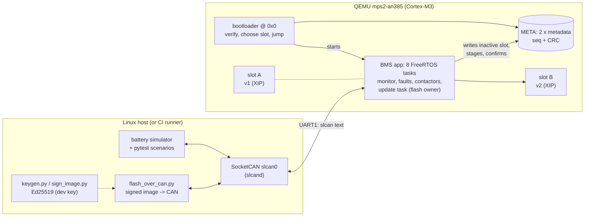
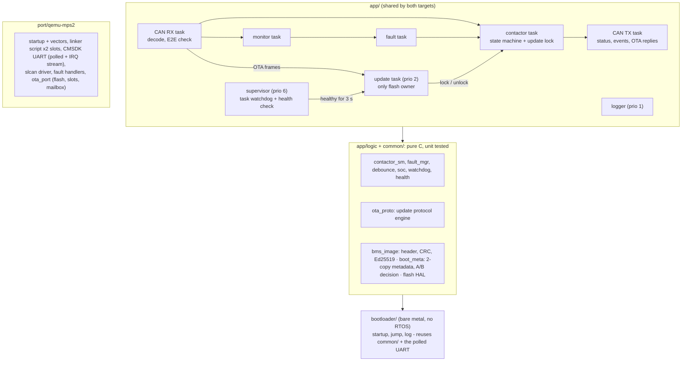
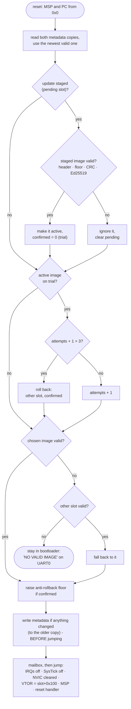
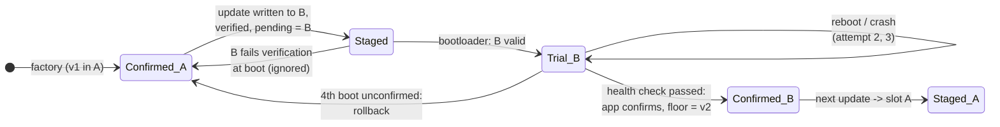
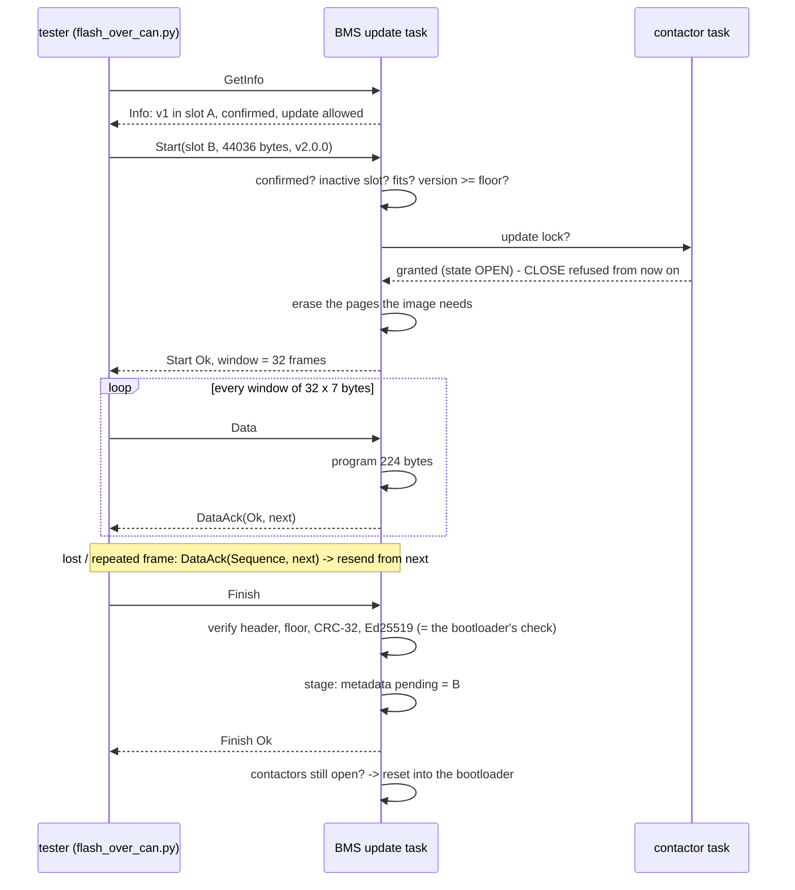
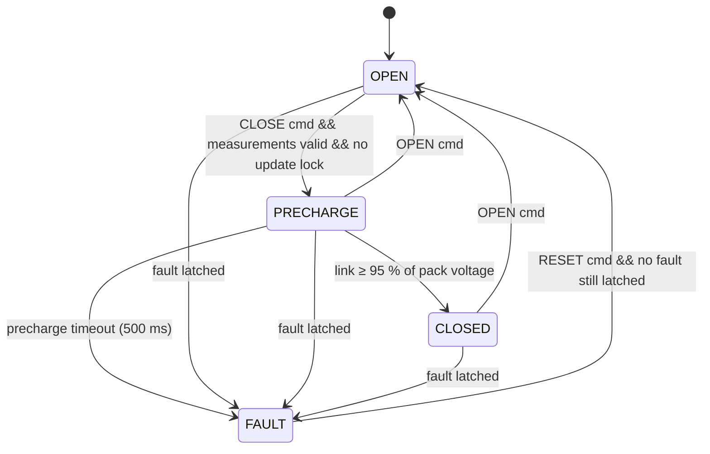

# BMS firmware: FreeRTOS on Cortex-M3, a secure A/B bootloader and firmware updates over CAN

A simulated automotive **battery management system** for a 12-cell lithium-ion pack, built the way production
ECU firmware is: a FreeRTOS application that monitors cells and drives the HV contactors, a **bare-metal
bootloader** that only starts **Ed25519-signed** images, **A/B slots with trial boot and automatic rollback**,
**anti-rollback**, power-loss-safe metadata, and **over-the-air updates over CAN** that the BMS refuses unless the
contactors are open. It runs on an emulated Cortex-M3 (QEMU `mps2-an385`) and talks CAN to a Python battery
simulator, so the whole thing is testable end to end without hardware.

> **Demo** - *placeholder:* `docs/demo.gif`. Record it with
> `asciinema rec demo.cast -c "bash scripts/demo.sh"` and convert with
> [`agg`](https://github.com/asciinema/agg) `demo.cast docs/demo.gif`. The demo boots v1, closes the contactors,
> overheats a cell (contactors open in ~200 ms), resets, updates to v2 over CAN, watches v2 confirm itself, and
> has a forged update rejected.

**At a glance**
- **Bootloader** (15.6 KB of its 64 KB region): reads two-copy metadata, picks a slot, verifies header, anti-rollback
  floor, CRC-32 and an Ed25519 signature (Monocypher, RFC 8032), and hands over with VTOR/MSP/SysTick/NVIC reset by
  the book. Nothing valid → it stays put and says so.
- **A/B updates**: images execute in place, so the app is linked for both slots; a new image boots on **trial**,
  must pass a health check to **confirm** itself, and is **rolled back** after 3 boots without confirmation - also
  when it crashes, because fatal handlers reset the ECU.
- **Power-loss safe**: metadata lives in two flash pages with sequence numbers and CRCs; unit tests cut the power
  at every byte of a metadata write and the device always comes back in the old or the new state, never in between.
- **Flash HAL** with real NOR semantics on QEMU's RAM "flash": page erase, program-only-clears-bits, 8-byte units,
  write protection, and fault injection (failed write, power cut after N bytes).
- **Update protocol over CAN**: windowed transfer with cumulative ACKs, go-back-N retransmission and timeouts, on
  the lowest-priority IDs; the BMS writes the inactive slot, verifies it exactly as the bootloader will, stages it
  and reboots. **Safety interlock**: the contactor state machine grants the "update lock" only while the contactors
  are open and then refuses CLOSE; cell monitoring keeps running underneath the transfer.
- **The BMS itself**: contactor state machine with precharge, debounced and latched faults (OV/UV/OT/OC, sensor loss,
  precharge timeout, task watchdog), E2E-protected CAN, coulomb counting, static allocation only - on the Cortex-M3
  there is no heap at all.
- **Tests**: 179 unit tests (Unity, ASan/UBSan) including RFC 8032 vectors and torn-write sweeps; 18 offline
  pytest checks that the DBC, the C headers and the Python tools agree; 24 end-to-end scenarios (14 BMS + 10
  update scenarios) against the real firmware over CAN; CI on every push.



**Quick start** (Linux; details in [Running on QEMU](#running-on-qemu)):

```bash
git clone --recursive <repo> && cd bms-firmware
pip install -r sim/requirements.txt         # python-can, cantools, pytest, cryptography
make TARGET=qemu                            # bootloader + app for slot A and B, signed (dev key auto-generated)
make test                                   # 179 unit tests
bash scripts/demo.sh                        # the story above (needs can-utils + the slcan module)
make scenario TARGET=qemu                   # all end-to-end scenarios, incl. firmware updates
```

## Contents

[Architecture](#architecture) ·
[Memory map](#memory-map) ·
[Boot flow](#boot-flow) ·
[Trial boot and rollback](#trial-boot-and-rollback) ·
[Images and signing](#images-and-signing) ·
[Metadata and power loss](#metadata-and-power-loss) ·
[Update protocol](#update-protocol-over-can) ·
[Safety interlock](#safety-interlock) ·
[Threat model](#threat-model) ·
[Why two builds](#why-the-app-is-linked-twice) ·
[QEMU and reset](#qemu-and-reset) ·
[CAN ID map](#can-id-map) ·
[POSIX build](#build-run-test-posix-simulator) ·
[QEMU](#running-on-qemu) ·
[Memory usage](#memory-usage-cortex-m3) ·
[Timing on QEMU](#timing-on-qemu) ·
[Tests](#test-overview) ·
[Real hardware](#what-would-change-on-real-hardware) ·
[Limitations](#known-limitations) ·
[Layout](#repository-layout)

## Architecture

The same application code builds for two targets:

| Target | Runs on | CAN link | Bootloader / updates |
|--------|---------|----------|----------------------|
| `TARGET=qemu` | FreeRTOS ARM_CM3 port on QEMU **mps2-an385** (Cortex-M3), arm-none-eabi-gcc | **slcan** ASCII frames on UART1 → pty → `slcand` → SocketCAN `slcan0` | yes |
| `TARGET=posix` | FreeRTOS POSIX port, a Linux process | SocketCAN `vcan0` | no (no flash on the host) |



**Layering rules**
- `app/logic/` and `common/` are pure C11 with no FreeRTOS or OS includes; unit tests link only those, so an OS call
  sneaking in breaks the test build. The update protocol (`ota_proto.c`), the A/B decision (`boot_meta.c`) and the
  image checks (`bms_image.c`) are all host-testable - the bootloader and the update task are thin wrappers.
- The bootloader shares `bms_image.c`, `boot_meta.c`, `flash_emul.c`, `crc32.c` and the polled UART driver with the
  application: the check that decides whether an update gets staged is literally the bootloader's check.
- `port/<target>/` is the only place that knows addresses and registers ([`ota_port.h`](common/include/ota_port.h)
  is the whole contract the update logic needs from the platform).

**Task priorities.** Supervisor (6) > CAN RX (5) > fault, contactor (4) > monitor, CAN TX (3) > **update (2)** >
logger (1). The update task does the slow work - flash writes and a ~7 M-instruction signature check - below
everything that monitors cells or reacts to faults, so a transfer only gets the CPU time they leave.

## Memory map

All addresses live in [`port/qemu-mps2/memory_map.h`](port/qemu-mps2/memory_map.h); both linker scripts are run
through the C preprocessor and include it, so code and linker never disagree. The AN385 has no flash: the 4 MB SSRAM1
at `0x0`, which the core boots from, plays that role, with flash rules enforced by the [flash HAL](#flash-hal).

| Region | Start | Size | Contents |
|--------|-------|------|----------|
| BOOT   | `0x0000_0000` | 64 KB  | bootloader (15.6 KB used); write-protected by the flash HAL |
| META   | `0x0001_0000` | 64 KB  | metadata copy 0 at `0x1_0000`, copy 1 at `0x1_1000` (separate 4 KB erase pages) |
| SLOT_A | `0x0002_0000` | 1 MB   | image A: 256 B header, vector table at `+0x100`, code, `.data` initial values |
| SLOT_B | `0x0012_0000` | 1 MB   | image B, same layout, linked for this address |
| -      | `0x0022_0000` | 1.9 MB | unused |
| RAM    | `0x2000_0000` | 4 MB − 4 KB | `.data`, `.bss`, task stacks, MSP stack at the top (the bootloader uses the same RAM before the app) |
| SHARED | `0x203F_F000` | 4 KB   | bootloader → app mailbox ([`boot_info.h`](common/include/boot_info.h)): slot, boot reason, trial attempt |

VTOR needs the 48-entry vector table aligned to 256 bytes, which is why the image header is exactly 256 bytes.

## Boot flow



The decision itself is a pure function, [`boot_decide()`](common/src/boot_meta.c), with 15 unit tests; the jump is
[`boot_jump.c`](bootloader/boot_jump.c), every step commented. Persisting the attempt counter *before* the jump
matters: a trial image that crashes or hangs still uses up its attempt. If that write fails, the bootloader starts
the previous image instead of an image whose attempts it cannot count. A real log:

```
BOOT  BMS bootloader (A/B, Ed25519 key 8cd068ce)
BOOT  metadata: copy 1 (seq 2)
BOOT  active A (confirmed, 0 trial boots), pending B, minimum version v1.0.0
BOOT  slot B: v2.0.0, 43780 bytes, CRC and signature ok (6976 us)
BOOT  starting slot B: trial boot of a new image 1 of 3
```

## Trial boot and rollback



- **Fields** ([`boot_meta.h`](common/include/boot_meta.h)): active slot, pending slot, confirmed flag, boot attempt
  counter, minimum version - plus sequence number and CRC.
- **Confirm** = the supervisor's health check ([`health.c`](app/logic/health.c)): every task checking in with the
  watchdog and no fault latched or active, continuously for `BMS_CONFIRM_HEALTHY_MS` (3 s here; a vehicle would want
  a drive cycle's worth of evidence). The update task then writes `confirmed = 1` and raises the floor.
- **No update while on trial**: the inactive slot holds the image a rollback returns to, so the BMS refuses to
  overwrite it until the running image is confirmed.
- **Crashing images** are rolled back without any outside help: the HardFault/assert/stack-overflow handlers print
  their report and reset the ECU (`FATAL_HALT=1` keeps the old halt-for-GDB behaviour), and each reset uses up an
  attempt. `make test-images` builds two signed-but-broken v2 releases (one never confirms, one crashes after 1.5 s)
  to prove it.

## Images and signing

Every slot starts with a 256-byte header ([`bms_image.h`](common/include/bms_image.h)); the vector table follows.

| Offset | Field | |
|--------|-------|-|
| `0x00` | magic `"BMSI"` | |
| `0x04` | header size, header version | |
| `0x08` | image version | `major << 16 \| minor << 8 \| patch`, compared as an integer |
| `0x0C` | image size | payload bytes after the header |
| `0x10` | CRC-32 | of the payload |
| `0x14` | load address, vector table | the slot it was linked for, `+0x100` |
| `0x1C` | flags, reserved | zero |
| `0xC0` | **Ed25519 signature** | over **SHA-512(header bytes `0x00..0xBF` ‖ payload)** |

The signature sits inside the header it protects, so the signed bytes are not contiguous: hash-then-sign, as MCUboot
does - a standard pure Ed25519 signature over the 64-byte digest, which Python's `cryptography` produces and
Monocypher's `crypto_ed25519_check` verifies (RFC 8032 vectors in [`test_ed25519_vectors.c`](tests/test_ed25519_vectors.c),
including the non-canonical-S malleability case). Every header field above the signature is covered, so neither the
version nor the size nor the load address can be changed without breaking it.

Checks run cheapest first: magic/layout → load address = this slot → size fits → **version ≥ floor** → **CRC-32**
(a clear "corrupted" diagnosis, but not security: anyone can fix up a CRC) → **signature** → vector-table sanity
(initial SP in RAM, Thumb reset handler inside the image). The header bytes that are hashed are the copy every decision
is made from, so what is checked is what is used.

**Keys.** `tools/keygen.py` creates `keys/dev_ed25519.pem` (mode 0600) on the first build; `keys/` is git-ignored
and only `keys/README.md` is committed. The build compiles only the **public** key into the bootloader and the app.
**Production would never hold the private key on a developer machine or CI runner: it would live in an HSM behind a
signing server** that signs digests for an authenticated release pipeline (see [keys/README.md](keys/README.md)).

```bash
make TARGET=qemu VERSION=1.2.0          # images carry their version in the signed header
python3 tools/sign_image.py --key keys/dev_ed25519.pem --version 2.0.0 build/qemu/app_slotB.bin -o v2.bin
```

**Measured cost** of verifying a 43.8 KB image (CRC-32 + SHA-512 + Ed25519) in the bootloader: **≈7.0 million
instructions**, counted under QEMU's `-icount shift=0` (one instruction per guest nanosecond; the bootloader times the
check with SysTick). On a real 25 MHz Cortex-M3 that is roughly 0.3-0.4 s per boot (CPI 1-1.5), about 0.1 s at 72 MHz.

## Metadata and power loss

Two copies of a 32-byte record, each in its own 4 KB erase page of META, each with a **sequence number** and a
**CRC-32** written last. Reading picks the valid copy with the highest sequence number (wrap-safe). Writing always
goes to the **other** copy: erase its page, program the record with sequence + 1.

**Why that survives a power cut at any instant:** a write only ever touches the copy that is *not* the current state.
If power fails during the erase or the programming, that copy is torn, its CRC fails, and the next boot falls back to
the untouched copy - the state before the write. Once the last bytes (the CRC) are programmed, the new copy is valid
and newest - the state after it. There is no instant at which the current state is lost, and no instant at which a
half-written state reads as valid (except the 2⁻³² chance that a torn record happens to match its CRC). The unit
tests prove it exhaustively: a power cut after *every* byte count of a metadata write, and at a range of points in
the erase ([`test_boot_meta.c`](tests/test_boot_meta.c)). In normal operation nothing is written at all: the
bootloader writes only during trial boots and rollbacks, so steady-state boots cost no flash wear.

### Flash HAL

[`flash_hal.h`](common/include/flash_hal.h) is the interface a real flash driver would implement; on QEMU
[`flash_emul.c`](common/src/flash_emul.c) enforces the rules on RAM:

- erase in 4 KB pages, to `0xFF`; programming can only clear bits - writing over non-erased data fails, and the whole
  range is validated before anything changes (a controller refuses rather than half-programs);
- 8-byte program units at aligned addresses (STM32L4/G4 double-words); no unit is ever programmed twice, so the code
  would also run on ECC flash that allows only one program per unit;
- write protection: the bootloader protects BOOT, the app protects BOOT **and its own running slot**;
- **fault injection**: a failed program after N bytes, or a **power cut** after N programmed (or erased) bytes - the
  cell being written is left half-done, and on the target the handler resets the CPU immediately, like a brown-out.

## Update protocol over CAN



| ID | Message | Content |
|----|---------|---------|
| `0x6C0` | `BMS_OtaRequest` | `Start(slot, size u24, version u24)`, `Finish`, `Abort`, `GetInfo` |
| `0x6C1` | `BMS_OtaData` | `[seq][7 image bytes]` (last frame shorter) |
| `0x6C8` | `BMS_OtaResponse` | `[type][status][...]`: Start reply (window), DataAck (next frame), Finish/Abort replies, Info (slot, version, confirmed, session, boot reason, attempt) |

**Statuses:** `Ok`, `NotSafe` (contactors not open), `Busy` (image on trial or update already staged), `BadSlot`,
`TooLarge`, `Downgrade`, `Sequence` (resend from `next`), `CrcError`, `BadSignature`, `BadImage`, `FlashError`,
`NoSession`, `Timeout`, `Incomplete` - the same table in [`ota_proto.h`](app/logic/ota_proto.h), the DBC and
[`bms_ota.py`](tools/bms_ota.py), checked against each other by `sim/tests/test_tools.py`.

- **Flow control**: the tester never has more than one window (32 frames) in flight; the update task's queue holds a
  window plus commands, so a well-behaved tester cannot overflow it. A window is 224 bytes - a whole number of 8-byte
  program units - so every flash write is aligned.
- **Retransmission**: go-back-N. On a gap the BMS sends one `Sequence` NACK and ignores the rest of the burst; the
  tester resends from the frame it names. If an ACK is lost, the tester resends the window after a timeout and the
  BMS answers with where it really is (or repeats the final ACK).
- **Timeouts**: tester 1-2 s per ACK, 8-10 silent retries; BMS abandons a session after 5 s without frames
  (`BMS_OTA_SESSION_TIMEOUT_MS`), releasing the update lock.
- **Early refusal**: Start already refuses the running slot, oversize images, an announced downgrade and - last,
  because it has a side effect - closed contactors. The binding checks are at Finish, on the signed header; the
  announced version is not signed and a test announces a lie to prove it does not matter.
- **Lowest-priority IDs** on the bus: on a real CAN bus, arbitration makes a transfer yield to every operational frame.
- **...which slcan does not have.** The first run of the update scenarios in the nested VM latched `MEAS_TIMEOUT`
  five seconds into a transfer: over slcan, frames travel through a serial line - a FIFO - so update bursts queued
  ahead of the simulator's cell data until it went stale, and the BMS correctly failed safe. The fix belongs to the
  link, not the firmware: `run_qemu.sh` restores arbitration order with a Linux **priority qdisc** on `slcan0`
  (`tc filter ... basic match 'canid(sff 0x6C0:0x7F0)'` puts the update IDs in the lowest band), and
  `flash_over_can.py --max-rate` paces data frames to a bus-load budget, as production flash tools do, for links
  without priority queueing.

```bash
python3 tools/flash_over_can.py --channel slcan0 --wait     # picks app_slot{A,B}.signed.bin for the inactive slot
python3 tools/flash_over_can.py --info
python3 tools/flash_over_can.py --interface slcan --channel socket://127.0.0.1:5555 --image v2.bin   # no SocketCAN
```

## Safety interlock

*"The BMS must refuse to start an update unless the contactors are OPEN, and must keep monitoring cells during the
transfer. Opening the contactors is never something the update process does itself."*

- **The contactor state machine decides.** Start asks the contactor task for the *update lock*; the request is
  answered inside the state machine step, together with any CLOSE command in that step, so there is no
  check-then-act race between two tasks. Granted only in OPEN; while held, CLOSE is refused
  (`close rejected: firmware update in progress`). The lock never opens anything - unit tests check that requesting it
  while CLOSED changes nothing.
- **Monitoring continues**: the update task runs below the monitor, fault and contactor tasks; CAN RX only forwards
  update frames, flash writes happen in the update task. A scenario test overheats a cell in the middle of a transfer
  and gets the fault event and FAULT state while the transfer is still running.
- **Activation re-checks**: Finish requires OPEN with no fault latched (a reboot would silently clear the fault), and
  the update task checks the contactors once more right before it resets the CPU. On success the lock is kept
  through the reboot.

## Threat model

**What the signed-image chain protects against**
- Running firmware not signed with the release key - modified, malicious or simply wrong builds - whether it arrives
  over CAN or is written straight into a slot: the bootloader verifies on every boot.
- Corruption in transit or in flash (CRC-32, then the signature).
- Downgrades to older, validly signed releases with known bugs (anti-rollback floor, raised when an image confirms,
  enforced by the update task *and* the bootloader).
- Moving an image to the other slot (the load address is signed; an XIP image would crash there anyway).
- Bricking by a signed but broken release (trial boot + rollback), and power loss at any point of an update.

**What it does not protect against**
- **Key compromise.** The dev key sits on disk; production needs an HSM, a signing service, separate dev/prod keys,
  and key rotation/revocation (several key slots in the bootloader, a signed revocation record). None of that exists.
- **Physical / debug access.** With SWD/JTAG an attacker can rewrite the bootloader, the public key or the metadata.
  Real hardware needs debug lock-out (e.g. STM32 RDP level 2), write protection of the bootloader in option bytes,
  ideally an immutable ROM root of trust, and the anti-rollback counter in OTP/eFuses rather than ordinary flash.
- **Confidentiality.** Images are signed, not encrypted: anyone on the bus can capture and reverse-engineer them.
- **An unauthenticated update protocol.** Anyone on the bus can start, interrupt or abort sessions (denial of
  service, or contactors held open while a session is live) - they just cannot get unsigned code to run. A production
  ECU would require UDS SecurityAccess (0x27) or authenticated messages (AUTOSAR SecOC) before an update session.
- **Fault-injection and side-channel attacks** on the verifier (voltage/clock glitching to skip the check). Hardened
  bootloaders double-check results and use glitch-resistant comparisons.
- **Reinstalling a version ≥ the floor** - by design (re-flashing the same release is allowed).

## Why the app is linked twice

The application executes in place from flash, so it contains absolute addresses (vector table, function pointers,
literal pools) for the slot it was linked for. Options:

| Approach | How | Cost |
|----------|-----|------|
| **Two XIP builds** (chosen; MCUboot calls it *direct-XIP*) | `app_slotA` and `app_slotB` from the same sources, different linker region; the updater sends the one for the inactive slot | two binaries per release; the tool must ask which slot is running |
| Swap / copy to one execution slot | one link address; the bootloader copies (or swaps, via a scratch sector) the new image into the primary slot | every update rewrites the primary slot (time, wear); a power-fail-safe swap needs its own progress log; rollback needs the old copy kept elsewhere |
| Position-independent code | `-fPIC` / `-msingle-pic-base`, a GOT, run-time relocation of pointers and the vector table | bigger, slower code; awkward with an RTOS port and a vector table full of absolute addresses; rarely done on MCUs |

Direct-XIP makes switching instant and rollback a metadata change, never a copy; the price is small here because the
build makes both images every time and the load address is part of the signed header (an image for slot A written to
B is refused). Common app and logic objects are compiled once; only the port files and the link are per slot.

## QEMU and reset

*Do images loaded with `-kernel` / `-device loader` survive a system reset?* Measured with
`AIRCR.SYSRESETREQ` from the firmware (the reboot test hook) and a host `system_reset`, on QEMU 10.0.13 and 11.1.2:

| Marker written into... | guest reset | host reset |
|------------------------|-------------|------------|
| slot A, inside the image loaded with `-device loader` (raw or ELF) | **restored** | **restored** |
| slot A, past the end of the loaded image | kept | kept |
| slot B, META, unused BOOT, RAM, SHARED (nothing loaded there) | kept | kept |

QEMU registers every loaded image as a "ROM blob" and copies it back on each reset (unless the target is a real ROM
region). So a slot loaded that way behaves like mask ROM: the *second* update - into slot A - would be silently undone
at the next reboot, while RAM that nothing was loaded into survives resets like flash.

**Chosen approach** ([`scripts/run_qemu.sh`](scripts/run_qemu.sh), [`scripts/qemu_flash.py`](scripts/qemu_flash.py)):
only the bootloader is loaded with `-kernel` (restoring it is harmless - on real parts it is write-protected), QEMU
starts halted, and a small GDB-remote-protocol client programs the slots and erases META once through QEMU's GDB stub,
like an SWD programmer at end of line. From then on only the firmware's flash HAL changes that memory, and it survives
`SYSRESETREQ` exactly as flash would. The test harness uses the same stub to "factory reset" the device between
update scenarios and to read the metadata.

**Tradeoff:** the "flash" lives as long as the QEMU process - a new QEMU process is a factory-fresh device, so power
loss is simulated by fault injection (the flash HAL resets the CPU part-way through a write) rather than by killing
QEMU. A persistent flash file would need machine support for a file-backed SSRAM1, or a dump/restore through the same
GDB stub around a restart.

## CAN ID map

All IDs are 11-bit standard; a lower ID wins arbitration, so safety events get the lowest and the update the highest.
Byte order is Intel. The full definition is [`dbc/bms.dbc`](dbc/bms.dbc).

| ID | Message | Sender → Receiver | Period | Content |
|------|-------------------|-------------|-------------|---------|
| 0x050 | `BMS_FaultEvent`  | BMS → all    | on event | FaultId, CellNumber, FaultValue, FaultsLatched, EventCounter |
| 0x060 | `VCU_Command`     | VCU → BMS    | on demand | **E2E**: CRC, AliveCounter, Command (1 close / 2 open / 3 reset) |
| 0x100 | `BMS_Status`      | BMS → VCU    | 100 ms + on change | **E2E**: CRC, AliveCounter, State, MeasValid, FaultsLatched, FaultsActive, SoC (0.01 %), PackVoltage (mV) |
| 0x200 | `SIM_PackMeas`    | SIM → BMS    | 10 ms  | PackCurrent (mA, + = discharge), LinkVoltage (mV) |
| 0x210 | `SIM_CellVoltages`| SIM → BMS    | 50 ms  | multiplexed: page 0-3 × 3 cells, mV |
| 0x220 | `SIM_CellTemps`   | SIM → BMS    | 50 ms  | multiplexed: page 0-3 × 3 cells, 0.1 °C |
| 0x6A0 | `BMS_TestHook`    | tester → BMS | debug  | stall a task, stack report, reboot, deliberate fault, flash write failure / power cut after N bytes (test builds only) |
| 0x6C0 | `BMS_OtaRequest`  | tester → BMS | update | Start / Finish / Abort / GetInfo |
| 0x6C1 | `BMS_OtaData`     | tester → BMS | update | sequence + 7 image bytes |
| 0x6C8 | `BMS_OtaResponse` | BMS → tester | update | replies, window ACK/NACK, info |

Fault bits: 0 CELL_OV, 1 CELL_UV, 2 CELL_OT, 3 PACK_OC, 4 MEAS_TIMEOUT, 5 PRECHARGE, 6 WATCHDOG. E2E: byte 0 is the
CRC-8 SAE J1850 over `[ID lo, ID hi, bytes 1..7]`, byte 1 bits 0-3 the alive counter; the receiver rejects bad CRCs and
repeated counters (stale or replayed frames).

### Contactor state machine



Precharge exists because closing straight onto the inverter's DC-link capacitor would draw an inrush current big
enough to weld the contactor tips; the link charges through a resistor first. OPEN and FAULT de-energise all three
relays (negative main, precharge, positive main).

## Build, run, test (POSIX simulator)

**Requirements:** Linux with gcc, make, Python ≥ 3.10, `cppcheck` for static analysis, `can-utils` optional.

```bash
sudo bash scripts/setup_vcan.sh         # creates vcan0 (make vcan does the same)
pip install -r sim/requirements.txt
make                # build/posix/bms_posix
make test           # unit tests (host) with ASan + UBSan
make cppcheck       # static analysis: both ports and the bootloader, fails on any finding
make scenario       # end-to-end scenarios on vcan0
make run            # terminal 1: firmware          make sim   # terminal 2: simulator shell
```

In the simulator shell: `close`, `load 120`, `heat 3 65` (cell 3 to 65 °C → FAULT within ~300 ms), `reset`, `cool 3`,
`stall`, `stacks`, `reboot`, `crash`, `help`. `cantools monitor -c vcan0 dbc/bms.dbc` decodes the bus live.

## Running on QEMU

**Extra requirements:** `gcc-arm-none-eabi` + `libnewlib-arm-none-eabi`, `qemu-system-arm`, `can-utils` (`slcand`),
the kernel's `slcan` module (Ubuntu: `linux-modules-extra-$(uname -r)`), Python with `cryptography` (image signing),
and `gdb-multiarch` for debugging. `slcand` and `ip` need root; `run_qemu.sh` uses `sudo` for those two steps.

```bash
make TARGET=qemu              # bootloader.elf, app_slotA/B .elf/.bin/.map, app_slotA/B.signed.bin, size report
make TARGET=qemu test-images  # the two broken-but-signed v2 releases for the rollback scenarios
make smoke TARGET=qemu        # headless: bootloader + slot A to "BMS ready" (CI)
make run TARGET=qemu          # QEMU + slcand -> slcan0; firmware log in the terminal
make sim TARGET=qemu          # (second terminal) simulator shell on slcan0
make scenario TARGET=qemu     # every scenario, including the update scenarios
bash scripts/demo.sh          # the demo story
```

| UART | QEMU option | Purpose |
|------|-------------|---------|
| UART0 (`0x40004000`) | `-serial file:<log>` | log, polled - bootloader and app |
| UART1 (`0x40005000`) | `-serial pty` → `slcand -o -c -s6 /dev/pts/N slcan0` | CAN as slcan text, interrupt-driven |

The harness starts one QEMU session and reboots the firmware over CAN before each BMS scenario; the update scenarios
instead **factory-reset** the device through the GDB stub (v1 in A, B and META erased) so each starts from the same
state. Tools also accept `--interface slcan --channel socket://127.0.0.1:5555` (python-can's own slcan client against
`-serial tcp:127.0.0.1:5555,server=on,wait=off`), which needs no SocketCAN and works on any OS.

**slcan on UART1.** [`common/src/slcan.c`](common/src/slcan.c) is the protocol (pure C, unit tested); the port moves
bytes. The RX interrupt feeds a FreeRTOS stream buffer that the CAN RX task parses (split frames, bad hex, wrong
lengths, extended/RTR frames are counted and dropped); TX encodes into a stream buffer drained by the TX interrupt,
kicked via NVIC set-pending. Interrupt priority 6, below `configMAX_SYSCALL_INTERRUPT_PRIORITY` (5) - priority 0 is the
reset default and the classic FreeRTOS-on-Cortex-M bug, caught here by `configASSERT`.

### Debugging with GDB

```bash
make debug TARGET=qemu    # QEMU halted at reset with the flash programmed, GDB stub on :1234
gdb-multiarch build/qemu/bootloader.elf -ex 'add-symbol-file build/qemu/app_slotA.elf' -ex 'target remote :1234'
(gdb) break boot_jump_to_app
(gdb) continue
(gdb) p/x *(unsigned *)0xE000ED08     # VTOR after the jump -> 0x00020100
```

### Fault reporting

`crash` in the simulator shell divides by zero (`CCR.DIV_0_TRP` → UsageFault → HardFault). The handler prints the
stacked registers, `EXC_RETURN`, CFSR/HFSR decoded into words and the task name, then resets:

```
*** HARD FAULT (task 'can_rx') ***
  PC   = 0x0002224E   LR = 0x00021749   CFSR = 0x02000000   HFSR = 0x40000000
  cause: escalated configurable fault (HFSR.FORCED):
    - UsageFault: integer divide by zero (DIVBYZERO)
Resetting.
```

`arm-none-eabi-addr2line -f -e build/qemu/app_slotA.elf <PC> <LR>` gives the faulting line and its caller.

## Memory usage (Cortex-M3)

Every `make TARGET=qemu` prints the per-region usage of all three images. With arm-none-eabi-gcc at `-Os`:

| Image | Flash | RAM |
|-------|------:|----:|
| bootloader | **15.6 KB** of 64 KB (24 %) | 72 B static (flash HAL state) + 8 KB stack, only while it runs |
| application (each slot) | 44 KB of 1 MB | 29.8 KB static: task stacks (16 KB), log queue, stream buffers |

Half of the application's growth since Phase 3 is the update path (Monocypher's SHA-512 + Ed25519 verify, the
protocol engine, the flash HAL). **Stack high-water marks** are logged 1 s after boot and on demand; sizes in
[`bms_port_config.h`](port/qemu-mps2/bms_port_config.h) are ~2× the measured peaks. The update task's peak, measured
across a whole transfer and signature check, is 684 words (2.7 KB); it gets 1408.

## Timing on QEMU

QEMU does not run in real time, so "cell at 65 °C → FAULT within 300 ms" needs checking on the emulator. The firmware
sends `BMS_Status` on a fixed 100 ms grid; `python -m bms_sim.timing --channel slcan0` measures how well the emulated
core's time tracks the host's.

| Host | QEMU mode | Status period (nominal 100 ms) | Firmware ÷ host clock | Scenario suite |
|------|-----------|-------------------------------|------------------------|----------------|
| Linux | default (no icount) | mean 100.2 ms, σ 1.8 ms | **0.998** | **pass** |
| Linux | `-icount shift=auto,sleep=on` | mean 107 ms, σ 144 ms, stalls up to 1 s | 0.93 | 15/20 |
| Linux | `-icount shift=auto,sleep=off` | mean 9.95 ms | **10.0** | 9/20 |
| Windows (busy) | default | mean 430 ms, max 1.3 s | 0.23 | - |

Without icount, SysTick follows the host clock: fine on Linux's high-resolution timers, badly late on a host with
coarse timers. With icount, guest time is instructions × 2^shift: deterministic and replayable, but no longer the
host's time, so a closed loop with a real-time simulator breaks. Hence: **no icount on Linux for closed-loop tests**
(the default), `-icount` for deterministic self-contained runs - like the instruction count of signature
verification above. The timeouts were not loosened to absorb either effect.

**Throughput.** The CMSDK UART has a 1-byte buffer and QEMU does not model baud rate; natively it moved 1,896
slcan frames/s. Nested inside an emulated VM (this project's development setup) the path manages ~210 frames/s;
`BMS_SIM_PERIOD_SCALE=2` halves the simulator's rate there, and the budgets scale with it by formula.

## Test overview

| Layer | Count | What it proves |
|-------|------:|----------------|
| Unit tests (Unity, host gcc, ASan + UBSan) | 179 in 17 suites | **image verification** (every header field covered, CRC fix-up does not fool the signature, wrong key, missing key, bad vectors, anti-rollback), **RFC 8032 Ed25519 vectors** incl. malleability, **flash HAL** semantics + fault injection, **metadata** (newest copy wins, corruption, wraparound, power cut at every byte), **A/B decision** (trial, 3-strike rollback, fallback, staged-image rejection, full lifecycle), **health timer**, **update lock**, plus the BMS logic (debounce, faults, state machine, SoC, watchdog, CRC/E2E, codec, FIFO, slcan) |
| Offline consistency (pytest) | 18 | DBC ↔ C headers ↔ Python tools: IDs, enums, status codes, image and metadata formats; signing round trips and tamper detection |
| BMS scenarios (pytest + vcan0 / slcan0) | 14 × 2 targets | fault reaction times, precharge, debounce, reset rules, sensor loss, watchdog, bad-CRC rejection, SoC |
| Update scenarios (QEMU only) | 10 | 1 valid update → trial → confirm · 2 corrupted image → rejected · 3 wrong key → rejected · 4 downgrade (honest and lying announcement) → rejected · 5 never-confirming and crashing releases → rolled back after 3 boots · 6 power cut mid-transfer and while committing → old image boots, next update works · 7 contactors closed → refused, nothing opened · monitoring + CLOSE refusal during a transfer |
| Boot smoke | 1 | bootloader + slot A boot headless to "BMS ready" |

Timing budgets come from `app/include/bms_config.h`: sim send period + N × monitor period + 50 ms processing - with
the overtemperature debounce N = 2 that is *cell at 65 °C → FAULT ≤ 300 ms*.

## What would change on real hardware

Taking an STM32 (say an L4/G4 with dual-bank flash) as the target:

- **Flash driver**: replace `flash_emul.c` with a driver for the flash controller implementing the same five
  functions (unlock, `PG`/`PER`, wait for `BSY`, check `PROGERR`/`WRPERR`, ECC). Pages are 2 KB; an erase takes tens of
  ms, which the protocol already accommodates (Start is answered after the erase). On a single-bank part, erasing or
  programming the bank the CPU executes from stalls instruction fetch - the update code would run from RAM, or A and
  B would go into separate banks for read-while-write.
- **Root of trust**: the bootloader write-protected in option bytes (WRP), debug locked (RDP), ideally the chip's
  secure-boot ROM verifying the bootloader; the anti-rollback floor in OTP or a monotonic counter.
- **Hardware watchdog** (IWDG) kicked by the supervisor only while every task is alive, so a hang also ends in a
  reset and uses up a trial attempt; the reset-cause register to tell watchdog from power-on resets.
- **Real CAN controller** (bxCAN/FDCAN) with hardware acceptance filters and true arbitration - the update yields to
  operational traffic, which slcan's FIFO cannot do; CAN FD would make transfers ~6× faster. UDS (0x34/0x36/0x37 over
  ISO-TP) with SecurityAccess instead of the custom protocol, so standard tester tools work.
- **Production programming** of the first image at end of line over SWD instead of the GDB-stub trick; keys in an HSM.
- **Cortex-M7 parts**: invalidate caches before the jump; MPU set up by the app.
- **Brown-out**: brown-out reset at a level where flash writes are still reliable; the metadata scheme already
  tolerates a cut at any byte.

## Known limitations

- Firmware updates exist on the Cortex-M3 target only; the POSIX build has no bootloader or flash.
- Over slcan there is no arbitration. `run_qemu.sh` emulates it on the host's transmit queue with a priority qdisc
  (needs the kernel's `em_canid` module); frames from the BMS to the host, and the UART itself, stay FIFO.
- The emulated flash lives as long as the QEMU process; power loss is tested with fault injection, not by killing QEMU.
- The update protocol is not authenticated (see the threat model); there is one signing key and no revocation;
  images are not encrypted.
- Confirmation is a simple health timer (3 s); no compressed or delta updates; the Start request carries version and
  size as 24-bit fields (images up to 16 MB, versions up to 255.255.255).
- The QEMU builds keep the test hooks (reboot, fault, flash fault injection) - a production build would compile them
  out (`BMS_ENABLE_TEST_HOOKS=0`).
- Stretch goal not done: UDS RequestDownload/TransferData/RequestTransferExit over ISO-TP.

## Repository layout

```
bootloader/                bare-metal bootloader: boot flow, commented jump to the app, startup, log, linker script
common/                    shared by bootloader, app and tests: image format + verification, two-copy metadata and
                           A/B decision, flash HAL (emulated, with fault injection), CRC-32, boot mailbox; CAN
                           interface, HAL interface, CRC-8/E2E, slcan codec, FIFO
app/include/bms_config.h   every threshold, debounce count and timing value
app/logic/                 pure C: contactor_sm (+ update lock), fault_mgr, debounce, soc, watchdog, health,
                           ota_proto (update protocol engine), bms_msgs (CAN codec)
app/tasks/                 FreeRTOS tasks incl. the update task, shared-state guards, logger, static creation
port/qemu-mps2/            Cortex-M3: memory map, linker script (per slot), startup, UART drivers, slcan CAN
                           driver, fault handlers, image header, ota_port
port/posix/                Linux: SocketCAN driver + RX bridge, hooks
tools/                     keygen.py, sign_image.py, flash_over_can.py, bms_image.py, bms_ota.py, boot_meta.py
scripts/                   run_qemu.sh, qemu_flash.py (GDB-stub programmer), qemu_smoke.sh, demo.sh, setup_vcan.sh
sim/                       battery simulator, CLI, timing tools, pytest suites (offline, BMS, update scenarios)
tests/                     Unity unit tests
dbc/bms.dbc                CAN database
keys/                      README only - development keys are generated here and never committed
third_party/               FreeRTOS-Kernel V11.3.1, Unity v2.6.1, Monocypher 4.0.3 (pinned submodules)
```

## Roadmap

- UDS over ISO-TP for the transfer (0x34/0x36/0x37, SecurityAccess 0x27), so standard testers can flash it
- Hardware watchdog in the QEMU port (the CMSDK APB watchdog is modelled), reset-cause reporting
- Key rotation: multiple public keys in the bootloader, signed revocation
- BMS features: cell balancing, SOP current limits, OCV-based SoC correction, DTC storage
- MISRA C checks, coverage reporting, CAN bus-off handling
